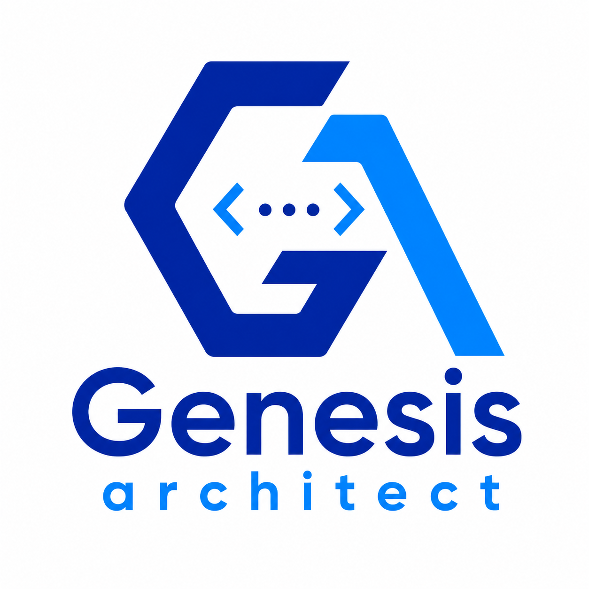
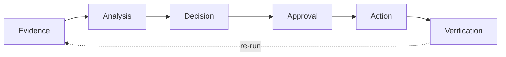

<div align="center">

<picture>
  <source media="(prefers-color-scheme: dark)" srcset="assets/logos/genesis_architect_white_on_black_300dpi.png">
  <source media="(prefers-color-scheme: light)" srcset="assets/logos/genesis_architect_blue_300dpi.png">
  
</picture>

# Genesis Architect

**An evidence-first engineering architecture, recovery and decision system.**

Research before you build. Understand before you change. Verify before you call substantial work done.

[](https://github.com/maioio/genesis-architect/actions)
[](https://pypi.org/project/genesis-architect/)
[](https://pypi.org/project/genesis-architect/)
[](LICENSE)

[Documentation](https://maioio.github.io/genesis-architect/) &middot;
[Getting started](https://maioio.github.io/genesis-architect/getting-started/) &middot;
[Capabilities](https://maioio.github.io/genesis-architect/capabilities/) &middot;
[Architecture](docs/architecture/overview.md) &middot;
[Contributing](CONTRIBUTING.md)

</div>

---

Before you build, Genesis studies comparable projects and the failures reported in their
issues, and turns that evidence into architecture options with the pitfalls attached. Before
you change existing code, it builds the import graph, scores the architecture and reports
what is fragile and why. When a decision is on the table, its decision engine runs the
relevant analysis, challenges the plan and runs gate checks that can stop the session or
wait for your answer. Every finding carries its source.

Analysis state goes to `.genesis/`. The report files of `recover`, `harden` and `decide` are
written after you approve them. `genesis purge` is a dry run until you pass `--apply`; the two
other deleting commands, `telemetry clear` and `fetch --discard`, act immediately.

The sources depend on how you run it:

- **The `genesis init` CLI** searches GitHub repositories, mines the issues of the top
  matches and summarises them with the LLM you configure.
- **The agent skill** (Claude Code, Cursor, Codex) can go further and combine GitHub with the
  web, MCP and community sources, package registries, security data and media that your agent
  has access to.
- **`genesis research`** does not search by itself. It merges and ranks evidence that the
  skill or you collected, and without input it prints what to collect.
- **The Genesis MCP server** is separate: read-only analysis tools that do not use the network.
- **The source registry** is the list of source types Genesis knows how to classify and rank.
  It is not queried on every run.

See [Research and evidence](https://maioio.github.io/genesis-architect/research-and-evidence/).

```bash
pip install genesis-architect
```

## Workflows

Workflows are journeys through several capabilities. They are not counted as capabilities.

| Workflow | Run | What happens |
|---|---|---|
| Start a new project | `genesis init "a Python CLI for analyzing log files"` | Researches GitHub repositories and their issues, writes `RESEARCH.md` and `PITFALLS.md`, and offers architecture options to choose from. The agent skill then builds the scaffold; outside an agent, `python -m genesis_architect.core.scaffold_generator` creates the folder structure |
| Recover an existing codebase | `genesis recover .` | Import cycles, broken imports, anti-patterns, fragile modules, drift and decay, without editing your source |
| Research | `genesis research "<topic>" --json-data FILE` | Merges and ranks collected evidence into pitfalls with sources |
| Decide and plan | `genesis decide "<instruction>"`, `genesis explain` | Classifies the request, runs the matching engines, a red-team pass and the gate checks, then asks before writing |
| Harden | `genesis harden .`, `genesis deps` | STRIDE threat model, OWASP Top 10 checklist, secrets scan, dependency advisories |

`recover` needs no API key, never executes your code and does not edit your source files. It
writes its own reports to `.genesis/` and `FRAGILITY_MAP.md` in the project directory. `init`
needs an LLM key and sends your description to GitHub and to that LLM
([configuration](https://maioio.github.io/genesis-architect/configuration/)).

## Demo

A recorded, reproducible walkthrough of both flows is in [`demo/`](demo/README.md). The
terminal output in it is captured from real runs, not written by hand.

## What the numbers mean

Genesis is run against its own source in CI. Every number below is rendered from the code,
and CI fails if this table drifts from the facts file.

<!-- facts:start -->
| Number | Value | What it counts |
|---|---|---|
| Architecture score | 93 / 100 | Modularity, coupling, cohesion and layering of this package, scored by its own analyzer |
| Import cycles | 0 | Cycles in this package's import graph |
| Critical anti-patterns | 0 | Critical findings from the anti-pattern detector on this package |
| Tests collected | 2,893 | `pytest --collect-only` on this repository |
| User-facing capabilities | 55 in 9 families | Things Genesis can do for a person, from the capability catalog. Workflows and integrations are not counted |
| Top-level commands | 22 | `genesis` subcommands, including advanced and legacy ones |
| Registered engines | 19 | Units the decision engine schedules. One engine can serve several capabilities |
| Decision modes | 7 | Plans the decision engine can run, such as recovery and research |
| Gate checks | 9 evaluated, 14 defined | Checks run on a decision session: 2 hard blocks, 7 block-and-ask, 5 warnings |
| Research source registry | 30 sources in 11 tiers | Sources Genesis knows how to classify and rank. Not a list queried on every run |
| MCP tools | 4 read-only | Analysis tools the Genesis MCP server exposes. They do not write files or use the network |

Generated for v9.0.0 from [`data/public-product-facts.json`](data/public-product-facts.json).

<!-- facts:end -->

The first self-audit (v9.0.0) found four import cycles and seven critical anti-patterns in
Genesis itself. The method and what was fixed are in
[docs/architecture/overview.md](docs/architecture/overview.md).

## How it works



1. **Evidence.** Public repositories and their issues for a new project; your own import graph for an existing one.
2. **Analysis.** Dependency graph from the AST, anti-pattern rules, architecture score.
3. **Decision.** Options with trade-offs, ranked against the evidence. Weak evidence is reported as `THIN`.
4. **Approval.** Gate checks run on the session. A hard block stops it and none of the proposed report files are written; block-and-ask waits for your decision. Proposed report files are written only after you approve (analysis state such as `.genesis/` and `FRAGILITY_MAP.md` is written during analysis).
5. **Action.** Only what you approved.
6. **Verification.** The analysis runs again and the result is compared.

## Capability families

A capability is something you can ask Genesis for. The catalog is generated from the code;
each family below lists what it contains.

<!-- families:start -->
| Family | Capabilities | Includes |
|---|---|---|
| Research & Evidence | 11 | New-Project Research Brief, Error Resolver, Research Orchestrator, Pitfall Ranker, Media Research, Video to Pitfall, Research Outline, Field Intelligence, Source Registry, Source Anchor, Evidence Pack |
| Existing Codebase Recovery | 7 | Recovery Scan, Recovery Report, Fragility Classifier, Drift Detector, Drift Scorer, Decay Regressor, Git Analyzer |
| Architecture Intelligence | 8 | Import Graph, Import Audit, Architecture Scorer, Anti-Pattern Detector, Refactoring Planner, C4 Generator, Knowledge Graph, Folder-Structure Generator |
| Decision & Planning | 7 | Decision Engine, Red Team Critic, Engine Bootstrap, Rules Engine, Architecture Committee, Decision Log, Intent Classifier |
| Security & Dependencies | 5 | Security Templates, Secrets Scanner, Dependency Scanner, Package Registry, Stdlib Filter |
| Memory & Learning | 5 | Product Intelligence, Cross-Session Memory, Project Memory, Learning Engine, Progress Report |
| Automation & Sync | 5 | Autonomous Sync, Skill Fetcher, Auto-Purge, Readiness Check, Release Drafts |
| Companion, UI & Voice | 5 | Companion UI, Companion Window, Companion Backend, Canvas Workspace, Voice Model Setup |
| Agents & MCP | 2 | MCP Advisor, MCP Tools |

55 capabilities in 9 families. The [capability catalog](https://maioio.github.io/genesis-architect/capabilities/) lists each one with its command, maturity, what it writes and what it needs.

<!-- families:end -->

### What needs what

| | Commands |
|---|---|
| Fully offline, no key | `research`, `engines`, `explain`, `memory`, `doctor`, `advise`, `ui`, `deps --no-cve` |
| Local engines, one optional lookup | `recover`, `harden`, `decide`: the engines run locally. Only a session in gate mode (`harden`, or a `decide` request that runs the gate) asks OSV.dev about up to 15 package names taken from Python imports; `recover` makes no OSV call, and non-Python projects have nothing to look up. If the lookup fails the session continues without it |
| Network | `init` (GitHub), `deps` (OSV.dev advisories, skipped with `--no-cve`; `--package NAME` skips the project scan and looks up one package in its public registry instead, PyPI by default, or npm, crates.io, Maven or NuGet via `--ecosystem`), `fetch` (git clone), `resolve` (Stack Overflow when the local vault has no answer), `publish` (LLM) |
| LLM key or local model | `init`, `publish`. `decide` adds an optional LLM critique and an optional committee debate with `ANTHROPIC_API_KEY`; when the key is missing it says so and continues with the deterministic engines |
| Writes into your project | `recover`, `harden` and `decide` write `.genesis/` and `FRAGILITY_MAP.md`; their report files (for example `PROJECT_RECOVERY_REPORT.md`, `docs/security/`) are written only after you approve (default is Defer) or pass `--yes`; `fetch` and `purge` act only in a sandbox or with `--apply` |
| Optional extras or tools | voice models, desktop notifications, native companion window (experimental), the `/watch` skill for video research, the MCP server (`pip install "mcp<2"`, then start it with `python -c "from genesis_architect.pro.mcp_tools import build_mcp_server; build_mcp_server().run()"`) |
| Kept for compatibility | `upgrade`, `license` (Genesis has no paid tier) |

Command reference: [Commands](https://maioio.github.io/genesis-architect/commands/).

## Integrations

- **Agent skill.** Genesis ships as an agent skill for Claude Code, Cursor and Codex. As a skill
  it may use whatever external MCP and web tools your agent has for research; those are your
  agent's tools, not Genesis's. See [Agent integrations](https://maioio.github.io/genesis-architect/agent-integrations/).
- **Genesis MCP server.** Read-only tools for the architecture score, anti-patterns, the
  recovery report and the architecture regression rules in `.genesis/rules.json`. They do not
  write files or use the network. See
  [MCP](https://maioio.github.io/genesis-architect/mcp/).
- **Completion Guardian (optional).** A separate tool that the agent-skill workflow can use
  before it calls substantial work done. The agent audits the project for what is missing or
  stale; Guardian fingerprints the project state, so a later change invalidates a clear
  verdict. Genesis does not bundle, install or require it, and works the same without it. It is
  a structured check, not an independent proof, and it is not counted as a capability. See
  [Completion Guardian](https://maioio.github.io/genesis-architect/completion-guardian/).

## When not to use it

Skip it for throwaway scripts and anything you will delete next week. Analysis is
Python-first. See [Limitations](https://maioio.github.io/genesis-architect/limitations/).

## Documentation

| | |
|---|---|
| [Getting started](https://maioio.github.io/genesis-architect/getting-started/) | Install and first run |
| [New projects](https://maioio.github.io/genesis-architect/new-projects/) | `init` and the scaffold in detail |
| [Existing projects](https://maioio.github.io/genesis-architect/existing-projects/) | `recover` in detail |
| [Research and evidence](https://maioio.github.io/genesis-architect/research-and-evidence/) | Where findings come from |
| [Approval model](https://maioio.github.io/genesis-architect/approval-model/) | Gate checks, approval and dry runs |
| [Capabilities](https://maioio.github.io/genesis-architect/capabilities/) | Every capability, generated from the code |
| [Commands](https://maioio.github.io/genesis-architect/commands/) | Every `genesis` command |
| [Completion Guardian](https://maioio.github.io/genesis-architect/completion-guardian/) | The optional final completeness check |
| [Security](https://maioio.github.io/genesis-architect/security/) | What Genesis does with your code |
| [Architecture](docs/architecture/overview.md) | How the analysis works, mechanism by mechanism |

The documentation site is built from [`site/`](site/). `pip install genesis-architect`
includes the former Pro engines as `genesis_architect.pro`, and there is no paid tier.
[`genesis-architect-pro/`](genesis-architect-pro/) holds the separate, unpublished Pro
distribution; you do not need it.

## Contributing and security

```bash
git clone https://github.com/maioio/genesis-architect
cd genesis-architect
pip install -e ".[dev]"
pytest -q
```

See [CONTRIBUTING.md](CONTRIBUTING.md) and the [Code of Conduct](CODE_OF_CONDUCT.md).
Report vulnerabilities privately as described in [SECURITY.md](SECURITY.md).

## License

[GNU AGPL-3.0-or-later](LICENSE). Copyright (C) 2026 Maio Eshet. Free to use, modify and
redistribute, including commercially; if you modify it and offer it over a network, publish
your changes under the same license. A commercial license for closed-source use is available
from maio.eshet@gmail.com. Releases up to v5.4.1 were MIT.

---

<div align="center">

If Genesis saved you from a bad architecture decision,
[star it](https://github.com/maioio/genesis-architect) so other people find it.

</div>
