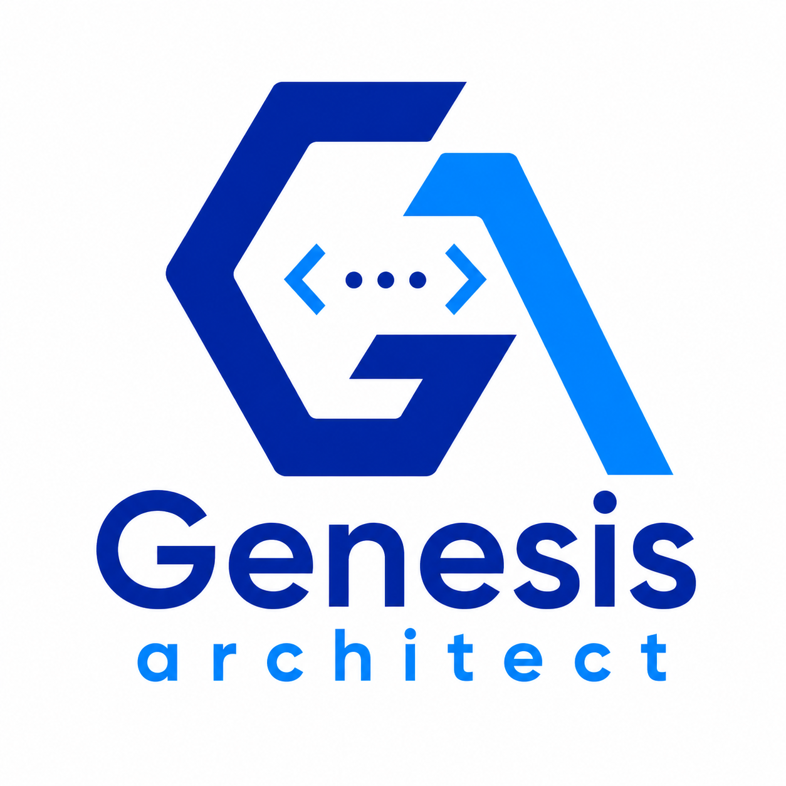
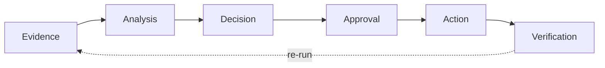

<div align="center">

<picture>
  <source media="(prefers-color-scheme: dark)" srcset="assets/logos/genesis_architect_white_on_black_300dpi.png">
  <source media="(prefers-color-scheme: light)" srcset="assets/logos/genesis_architect_blue_300dpi.png">
  
</picture>

# Genesis Architect

**Evidence-first architecture for real software.**

Research before you build. Understand before you change.

[](https://github.com/maioio/genesis-architect/actions)
[](https://pypi.org/project/genesis-architect/)
[](https://pypi.org/project/genesis-architect/)
[](LICENSE)

[Documentation](https://maioio.github.io/genesis-architect/) &middot;
[Getting started](https://maioio.github.io/genesis-architect/getting-started/) &middot;
[Architecture](docs/architecture/overview.md) &middot;
[Contributing](CONTRIBUTING.md)

</div>

---

Genesis researches across the software ecosystem before you build, using the sources
available in the current execution environment, then turns that evidence into architecture
options you approve. It mines the failures that keep recurring in comparable projects and
scaffolds with those mitigations already in place. For code that already exists, it builds
the import graph, scores the architecture, and reports what is fragile before anyone changes
it. Every recommendation carries its sources, and nothing acts without your approval.

The sources depend on how you run it. The standalone `genesis init` CLI researches GitHub
repositories and their issues. When Genesis runs as an agent skill, its research workflow can
combine GitHub with available web and MCP sources, community discussions, package registries,
security data and relevant media. Genesis's own MCP server is separate: four read-only
analysis tools that do not use the network. See
[Research and evidence](https://maioio.github.io/genesis-architect/research-and-evidence/).

```bash
pip install genesis-architect
```

| You have | Run | What happens |
|---|---|---|
| An idea | `genesis init "a Python CLI for analyzing log files"` | The CLI researches GitHub repositories and issues (an agent skill can add more sources), shows pitfalls with sources, you pick an architecture, it scaffolds |
| A codebase | `genesis recover .` | Diagnosis that leaves your source untouched: import cycles, anti-patterns, fragile modules, drift |

`recover` needs no API key, never executes your code and does not edit your source files. It writes its own reports to `.genesis/` and `FRAGILITY_MAP.md` in the project directory. `init` needs an LLM key and sends
your description to GitHub and to that LLM ([configuration](https://maioio.github.io/genesis-architect/configuration/)).

## Demo

A recorded, reproducible walkthrough of both flows is in [`demo/`](demo/README.md). The
terminal output in it is captured from real runs, not written by hand.

## Genesis audits itself

Genesis is run against its own source in CI. These figures are rendered from the code, and
CI fails if this table drifts from the facts file.

<!-- facts:start -->
| Measured on this repository | Value |
|---|---|
| Architecture score | 93 / 100 |
| Import cycles | 0 |
| Critical anti-patterns | 0 |
| Tests collected | 2,877 |
| Engines / approval gates | 19 / 14 |
| Mapped capabilities / commands | 50 / 22 |

Generated for v9.0.0 from [`data/public-product-facts.json`](data/public-product-facts.json).

<!-- facts:end -->

The first self-audit (v9.0.0) found four import cycles and seven critical anti-patterns in
Genesis itself. The method and what was fixed are in
[docs/architecture/overview.md](docs/architecture/overview.md).

## How it works



1. **Evidence.** Public repositories, issues and forks for a new project; your own import graph for an existing one.
2. **Analysis.** Dependency graph from the AST, anti-pattern rules, architecture score.
3. **Decision.** Options with trade-offs, ranked against the evidence. Weak evidence is reported as `THIN`.
4. **Approval.** Policy gates stop before any change. Mutating commands are dry-run by default.
5. **Action.** Only what you approved.
6. **Verification.** The analysis runs again and the result is compared.

## Capabilities

Genesis groups what it can do by the question you are asking. Each family links to the
complete table in the [capability catalog](https://maioio.github.io/genesis-architect/capabilities/),
which is generated from the code and lists maturity, what each capability writes and what it needs.

| Family | You ask | Start with |
|---|---|---|
| Research & Evidence | What have others learned building this? | `genesis research`, `genesis init` |
| New Project Architecture | Give me a starting structure that avoids known pitfalls | `genesis init` |
| Existing Codebase Recovery | What is fragile here and why? | `genesis recover .` |
| Architecture Intelligence | Cycles, anti-patterns, score, C4 diagrams, refactoring plan | `genesis recover .`, `genesis decide` |
| Decision & Planning | Which option, and what could go wrong? | `genesis decide "..."`, `genesis explain` |
| Security & Dependencies | Threat model, OWASP checklist, secrets, advisories | `genesis harden .`, `genesis deps` |
| Memory & Learning | Remember what we decided in this project | `genesis memory` |
| Automation & Sync | Keep checks running, fetch skill packs, clean up | `genesis sync`, `genesis fetch`, `genesis purge` |
| Companion, UI & Voice | A canvas workspace and a local health page | `genesis ui`, `genesis companion` |
| Agents & MCP | Use it from Claude Code, Cursor, Codex | `genesis advise`, [MCP](https://maioio.github.io/genesis-architect/mcp/) |

### What needs what

| | Commands |
|---|---|
| Fully offline, no key | `recover`, `harden`, `engines`, `explain`, `memory`, `doctor`, `advise`, `ui`, `decide` (deterministic engines) |
| Network | `research` (live search), `deps` (OSV.dev advisories), `fetch` (git clone), `resolve` |
| LLM key or local model | `init`, `publish`; `decide` can add an optional LLM critique that is disclosed when skipped |
| Writes into your project | `recover`, `harden` and `decide` write `.genesis/` and `FRAGILITY_MAP.md`; their report files (for example `PROJECT_RECOVERY_REPORT.md`, `docs/security/`) are written only after you approve (default is Defer) or pass `--yes`; `fetch` and `purge` act only in a sandbox or with `--apply` |
| Optional extras or experimental | voice, native companion window (experimental), committee critique, video research |
| Kept for compatibility | `upgrade`, `license` (Genesis has no paid tier) |

Command reference: [Commands](https://maioio.github.io/genesis-architect/commands/).

## Use it from your agent

Genesis ships as an agent skill for Claude Code, Cursor and Codex, and exposes four
read-only MCP analysis tools that do not use the network. As a skill it may also use whatever
external MCP and web tools your agent has for research; that is separate from the tools
Genesis exposes. Setup: [Agent integrations](https://maioio.github.io/genesis-architect/agent-integrations/)
and [MCP](https://maioio.github.io/genesis-architect/mcp/).

## When not to use it

Skip it for throwaway scripts and anything you will delete next week. Analysis is
Python-first. See [Limitations](https://maioio.github.io/genesis-architect/limitations/).

## Documentation

| | |
|---|---|
| [Getting started](https://maioio.github.io/genesis-architect/getting-started/) | Install and first run |
| [New projects](https://maioio.github.io/genesis-architect/new-projects/) | `init` in detail |
| [Existing projects](https://maioio.github.io/genesis-architect/existing-projects/) | `recover` in detail |
| [Research and evidence](https://maioio.github.io/genesis-architect/research-and-evidence/) | Where findings come from |
| [Approval model](https://maioio.github.io/genesis-architect/approval-model/) | Gates and dry-run |
| [Security](https://maioio.github.io/genesis-architect/security/) | What Genesis does with your code |
| [Architecture](docs/architecture/overview.md) | How the analysis works, mechanism by mechanism |

The documentation site is built from [`site/`](site/). The former Pro package source is kept
in [`genesis-architect-pro/`](genesis-architect-pro/). There is no paid tier.

## Contributing and security

```bash
git clone https://github.com/maioio/genesis-architect
cd genesis-architect
pip install -e ".[dev]"
pytest -q
```

See [CONTRIBUTING.md](CONTRIBUTING.md) and the [Code of Conduct](CODE_OF_CONDUCT.md).
Report vulnerabilities privately as described in [SECURITY.md](SECURITY.md).

## License

[GNU AGPL-3.0-or-later](LICENSE). Copyright (C) 2026 Maio Eshet. Free to use, modify and
redistribute, including commercially; if you modify it and offer it over a network, publish
your changes under the same license. A commercial license for closed-source use is available
from maio.eshet@gmail.com. Releases up to v5.4.1 were MIT.

---

<div align="center">

If Genesis saved you from a bad architecture decision,
[star it](https://github.com/maioio/genesis-architect) so other people find it.

</div>
