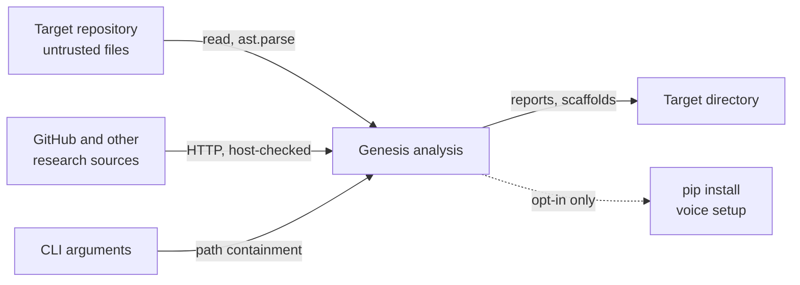

# Trust boundaries

Where data crosses from outside Genesis into it, and what is done at the crossing.

| Boundary | Direction | Control |
|---|---|---|
| Repository files into analysis | In | Parsed as text and syntax trees; never imported or executed |
| Research sources into ranking | In | Host matching on the parsed hostname; validation of repos, issue URLs and output paths |
| CLI paths into file writes | In | Resolved path must stay inside the base directory |
| Reports and scaffolds to disk | Out | Written under the target directory; secrets redacted in scan output |
| Package installation | Out | Voice setup only; `GENESIS_NO_AUTO_INSTALL=1` disables it |

Data sent to external services (research sources, or an LLM provider the user configures) is not
covered by a test in this repository, so no claim is made about what leaves the machine.

Evidence for each control is in [threat-model.md](threat-model.md).
